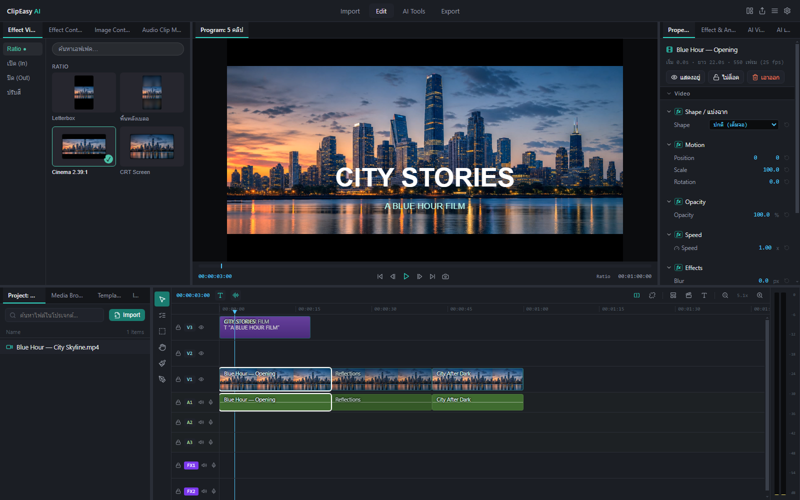
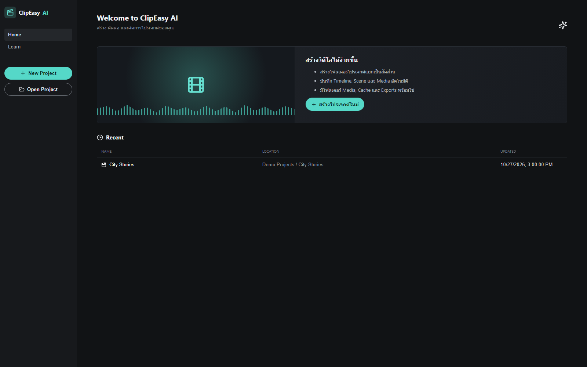
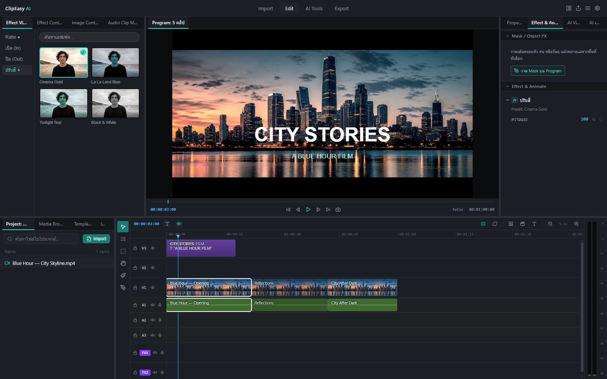
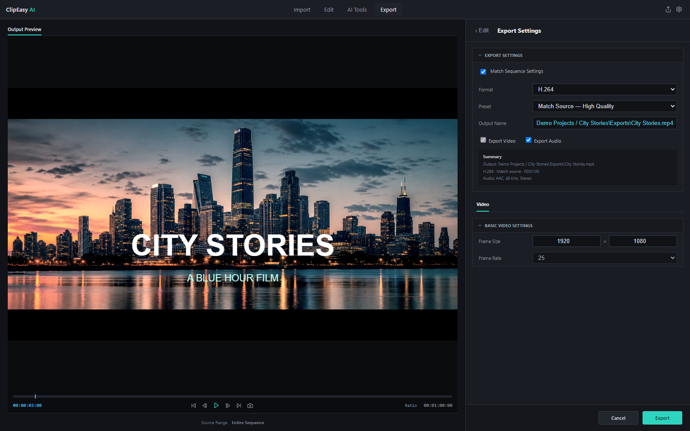
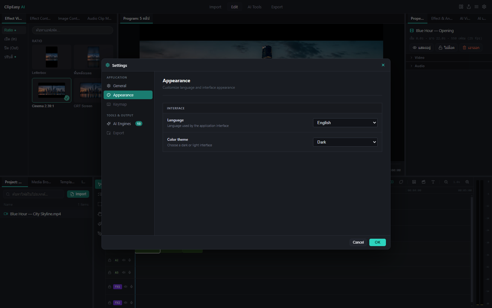

# ClipEasy AI

A local desktop video editor built with **Electron, React, FastAPI, Python, and FFmpeg**.

โปรแกรมตัดต่อวิดีโอบนเดสก์ท็อป พร้อม Timeline หลายแทร็ก ระบบโปรเจกต์ เอฟเฟกต์ภาพและข้อความ และเครื่องมือ AI ที่ติดตั้งเพิ่มแยกเป็นโมดูล



This repository presents the source and interface of an actively developed portfolio project. The editor runs locally; optional AI engines download their own dependencies and model files when installed.

## Highlights

- **Project workflow:** create a named project in a chosen folder, reopen recent projects, save manually or automatically, and keep Media, Cache, and Exports in the project folder.
- **Multi-track editing:** arrange video, images, text, and audio; trim and split clips; detach audio from video; preview the sequence in the Program monitor.
- **Visual controls:** position, scale, rotation, flips, opacity, image cropping, text animation, cinematic opening/closing effects, ratio treatments, and color-grade previews.
- **Mask / Object FX:** draw an editable polygon, move or adjust its points, enlarge the selected region, soften the edge, and set expand/hold/return timing with bounce.
- **Motion tracking:** approximate mask translation, rotation, and scale using optical flow, with saved tracking data and lost-track feedback.
- **Export:** FFmpeg-based H.264/H.265 output, source matching or resolution/frame-rate presets, edited audio, and Mask FX on video tracks V1–V3.
- **Optional AI engines:** an in-app manager for separate engine environments, covering workflows such as background removal, object removal, face censoring, speech recognition, and tracking. Availability and hardware requirements vary by engine.
- **Preferences:** dark/light appearance, Thai/English preferences, startup window size, and save mode.

## Screenshots

The screenshots use the actual application UI with a dedicated demo project and generated city imagery. They contain no customer projects or private media.

### Project home



### Effects and animation



### Export workspace



### Application settings



## Architecture

```text
Electron desktop shell
  ├─ project files, native dialogs, preferences, application menus
  └─ React editor
       ├─ Timeline, Program monitor, effects, Mask FX, export UI
       └─ HTTP → FastAPI on localhost
                    └─ Python core
                         ├─ FFmpeg video/audio processing
                         ├─ OpenCV mask rendering and tracking
                         └─ isolated AI engine workers
```

```text
api_server/          HTTP endpoints and background-job status
core/                video/audio processing, engines, tracking and workers
frontend/electron/   desktop integration and project persistence
frontend/src/        React interface and preview rendering
frontend/tests/      mask math, persistence, lifecycle and UI checks
frontend/portfolio/  isolated demo data used for portfolio screenshots
docs/screenshots/    captured application views
requirements.txt     base Python dependencies
```

## Run locally

The current development workflow targets **Windows**. Use Python **3.11+**, Node.js **20+**, npm, and FFmpeg/FFprobe available on `PATH`. An NVIDIA GPU is not needed for the basic editor; some optional AI engines have additional GPU requirements.

From the repository root, in PowerShell:

```powershell
python -m venv venv
.\venv\Scripts\python.exe -m pip install -r requirements.txt
.\venv\Scripts\python.exe -m uvicorn api_server.main:app --host 127.0.0.1 --port 8420
```

In a second terminal:

```powershell
cd frontend
npm ci
npm run electron:dev
```

The API health endpoint is `http://127.0.0.1:8420/health`. After installing the dependencies, `open.bat` can also start the development services.

AI model weights, engine virtual environments, generated exports, project media, and build output are deliberately excluded from Git. Install optional engines from **Settings → AI Engines**. Their own licenses and usage restrictions still apply.

## Verification

```powershell
cd frontend
npm run build
npm run test:mask
```

From the repository root:

```powershell
.\venv\Scripts\python.exe -m unittest core.test_mask_fx api_server.test_mask_track core.test_mask_export -v
```

The Mask FX checks cover source-coordinate editing math, animation phases, project save/reopen, stale tracking responses, actual tracking jobs, and encoded video/audio output. `frontend/tests/mask-ui.cjs` additionally exercises the mounted editor in Electron with a generated test clip.

To reproduce the portfolio screenshots, run the backend and Vite locally, then:

```powershell
.\venv\Scripts\python.exe frontend/portfolio/prepare-demo.py
cd frontend
.\node_modules\.bin\electron.cmd portfolio/capture.cjs
```

The capture entry loads the real editor with isolated demo data and saves the five views under `docs/screenshots/`. It does not access recent user projects.

## Current scope

This is a development project, not a finished production release. Basic editing and the listed Mask FX workflow are implemented, but not every preview feature has an export equivalent. In particular, Mask FX combined with Scene/image/text/layout layers or certain advanced visual effects is currently rejected with an explicit error. Some AI engines are listed as upcoming, and language support is still partial.

Installer packaging and complete preview/export parity remain ongoing work. The repository does not redistribute third-party model weights, external engine source trees, or an FFmpeg binary.

## Project owner

[worasakthaicodex](https://github.com/worasakthaicodex)
